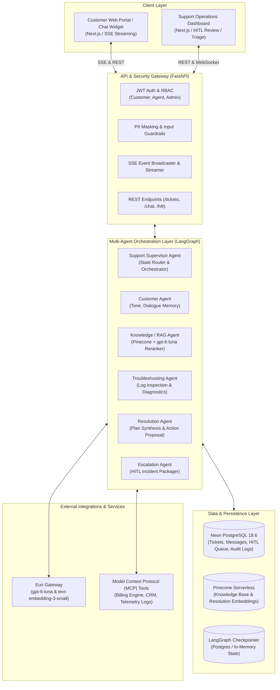
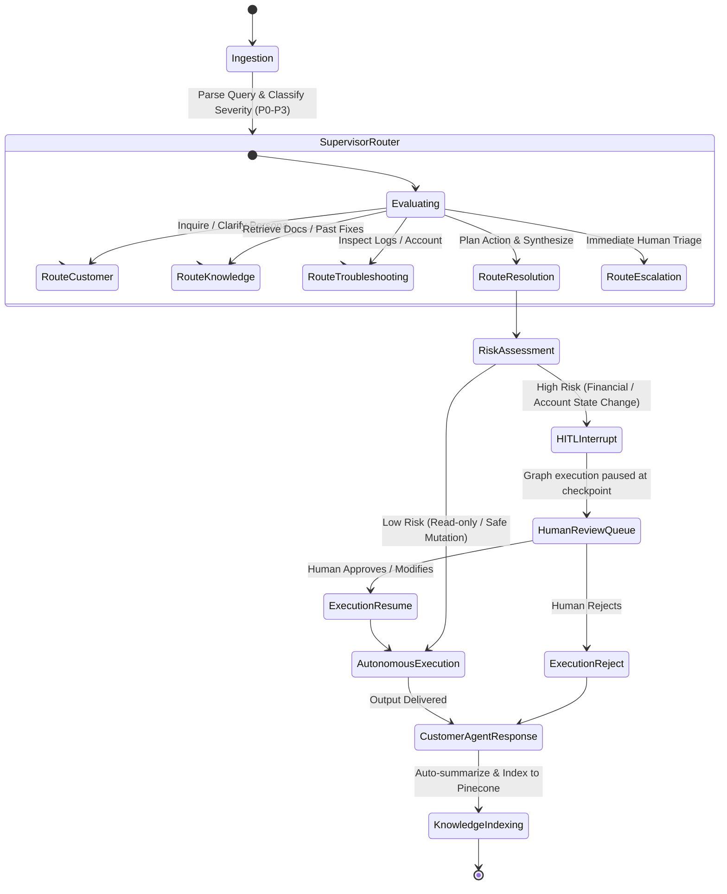
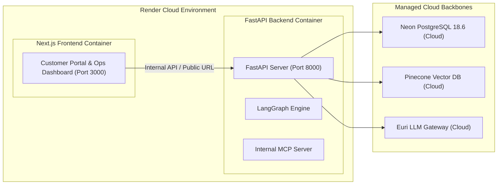

# High-Level Design (HLD) Document
## Autonomous Customer Support & Resolution Platform

---

### 1. Executive Summary & System Objectives
Modern digital enterprises struggle with high-volume, fragmented customer service requests across web chat, tickets, and email. Standard chatbot solutions are passive and read-only: they regurgitate canned text without diagnosing root causes, inspecting account state, executing operational mutations, or learning from past resolutions.

The **Autonomous Customer Support & Resolution Platform** is an enterprise-grade multi-agent autonomous system capable of:
1. **Understanding & Triaging**: Parsing ambiguous natural language queries and classifying priority/severity (P0 Outage, P1 Financial, P2 Feature, P3 Minor).
2. **Context Hydration & Investigation**: Querying customer records, transaction logs, and diagnostic health states via standard **Model Context Protocol (MCP)** tools.
3. **Hybrid RAG Retrieval**: Combining dense vector search on **Pinecone** with sparse lexical BM25 matching, reranked by **`gpt-6-luna`** for zero-overhead, highly accurate context retrieval.
4. **Autonomous Resolution & Action Execution**: Generating deterministic resolution plans and executing safe, approved operational mutations.
5. **Human-in-the-Loop (HITL) Gate**: Interrupting agent execution via LangGraph `interrupt()` breakpoints for high-risk actions (refunds > $50, tier downgrades, account cancellations) to obtain explicit human sign-off.
6. **Continuous Learning**: Auto-summarizing resolved tickets and indexing validated solutions into Pinecone for future retrieval.

---

### 2. High-Level System Architecture

---

### 3. Multi-Agent State Machine Topology

The multi-agent core is modeled as a stateful cyclical directed graph in **LangGraph**:

---

### 4. Technology Stack & Component Mapping

| Subsystem | Technology | Justification & Production Role |
| :--- | :--- | :--- |
| **Frontend Framework** | **Next.js 14/15 (App Router)** + **Tailwind CSS** | Server-side rendering, responsive support dashboard, SSE streaming customer widget, Lucide icons. |
| **Backend Framework** | **FastAPI (Python 3.12)** + **Uvicorn** | High-performance asynchronous REST and SSE streaming; native Pydantic validation. |
| **Multi-Agent Runtime** | **LangGraph 0.3+** + **LangChain 0.3+** | Stateful cyclical agent execution, deterministic conditional routing, native `interrupt()` breakpoints. |
| **Foundation LLM** | **`gpt-6-luna`** (via Euri Gateway) | High-speed, high-reasoning LLM used for routing, synthesis, action planning, and document reranking. |
| **Embeddings** | **`text-embedding-3-small`** (1536 dim) | Industry standard semantic representation for technical documentation and ticket resolution pairs. |
| **Relational Database** | **Neon Serverless PostgreSQL 18.6** | Multi-schema relational storage for tickets, customer profiles, audit trails, and HITL action queues. |
| **Database Drivers** | **`psycopg 3`** & **`asyncpg`** | Latest async/sync PostgreSQL database drivers with full pooling and SSL support. |
| **Vector Database** | **Pinecone Serverless** (`support-knowledge-base`) | Fully managed high-performance cosine similarity vector store for Hybrid RAG. |
| **Reranking Engine** | **`gpt-6-luna` LLM Reranker** | Zero memory overhead on Render (no PyTorch/HuggingFace dependencies), superior context comprehension. |
| **Deployment Target** | **Render** (Web Service + Static/Node Site) | Dockerized backend and Next.js frontend with low footprint and automated continuous deployment. |

---

### 5. Deployment Architecture (Render Blueprint)

- **Backend Web Service**: Multi-stage lightweight Python Dockerfile (< 180MB RAM), utilizing Uvicorn with asyncpg connection pooling.
- **Frontend Web Service / Static**: Next.js Dockerfile with standalone output mode for lightning-fast SSR performance.
- **Environment Management**: Unified `.env` secrets configured in Render dashboard (`EURI_API_KEY`, `DATABASE_URL`, `PINECONE_API_KEY`, etc.).

---

### 6. Security, RBAC & Enterprise Guardrails

1. **Authentication & Authorization**:
   - JWT tokens signed with SHA-256 (`APP_SECRET`).
   - Role-Based Access Control (**RBAC**):
     - `Customer`: Can create tickets, chat with assigned ticket sessions, view their own profile.
     - `Support Agent`: Can view triage queue, inspect agent execution traces, approve/modify/reject HITL actions.
     - `Admin`: Full access, including audit logs, system configuration, and evaluation benchmarks.
2. **Input/Output Guardrails**:
   - PII Redaction: Automatic masking of Credit Card numbers, Social Security Numbers, and API keys before logging or LLM transmission.
   - Prompt Injection Defense: Structured validation against system prompt override patterns.
3. **Auditability & Traceability**:
   - Immutable audit logging in PostgreSQL recording every agent decision, tool execution, human approval, and mutation timestamp.
