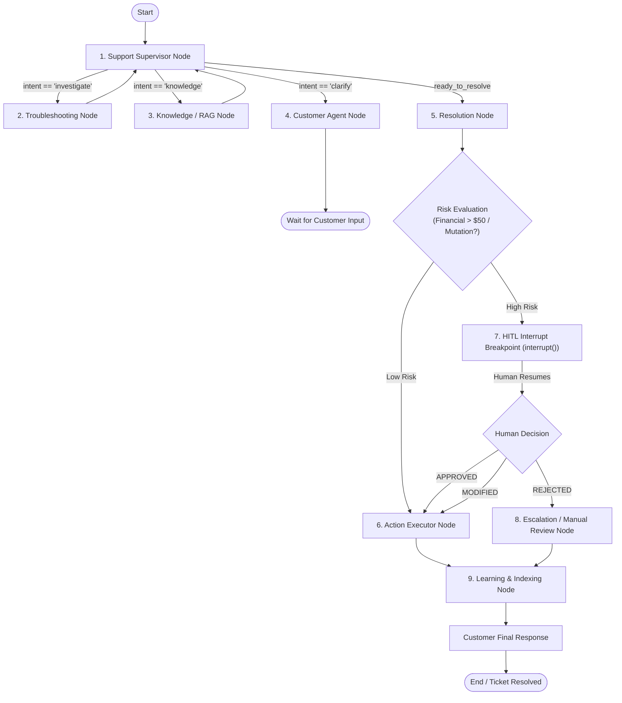

# Low-Level Design (LLD) Document
## Autonomous Customer Support & Resolution Platform

---

### 1. LangGraph State Schema (`GraphState`)

The complete multi-agent lifecycle is governed by the state dictionary passed across all nodes in the state graph:

```python
from typing import Annotated, Literal, Optional, List, Dict, Any
from typing_extensions import TypedDict
from langchain_core.messages import BaseMessage
from langgraph.graph.message import add_messages

class AgentTraceStep(TypedDict):
    timestamp: str
    agent_name: str
    action_type: str
    summary: str
    details: Dict[str, Any]

class GraphState(TypedDict):
    # Core Conversational Memory
    messages: Annotated[List[BaseMessage], add_messages]
    ticket_id: str
    customer_id: str
    
    # Classification & Context
    intent: str
    severity: Literal["P0", "P1", "P2", "P3"]
    customer_profile: Optional[Dict[str, Any]]
    
    # Investigation & Retrieval
    retrieved_docs: List[Dict[str, Any]]
    diagnostic_findings: List[Dict[str, Any]]
    
    # Resolution & Risk Evaluation
    proposed_plan: Optional[str]
    proposed_action: Optional[Dict[str, Any]]
    action_risk_level: Literal["LOW", "HIGH"]
    
    # Human-in-the-Loop (HITL) State
    hitl_action_id: Optional[str]
    hitl_status: Optional[Literal["PENDING", "APPROVED", "MODIFIED", "REJECTED"]]
    hitl_review_notes: Optional[str]
    human_modified_action: Optional[Dict[str, Any]]
    
    # Execution & Final Output
    action_execution_result: Optional[Dict[str, Any]]
    resolution_summary: Optional[str]
    agent_trace: List[AgentTraceStep]
    next_node: str
```

---

### 2. Node Specifications & Transition Logic



#### Node Details:

1. **`supervisor_node`**:
   - Parses the latest message using `gpt-6-luna`.
   - Classifies ticket severity:
     - `P0`: Outages, core service failures, catastrophic data loss.
     - `P1`: Billing disputes, unauthorized charges, subscription access blocks.
     - `P2`: Feature malfunction, integration errors, API rate limit issues.
     - `P3`: General guidance, how-to, documentation inquiries.
   - Evaluates whether account context, diagnostic logs, or technical documentation are missing, and routes dynamically.

2. **`customer_agent_node`**:
   - Formulates natural, empathetic, and professional customer responses.
   - Preserves persona tone according to customer tier (e.g. VIP handling for Enterprise tier).

3. **`knowledge_rag_node`**:
   - Executes hybrid retrieval:
     - **Pinecone**: Dense vector semantic query using `text-embedding-3-small`.
     - **BM25**: Lexical sparse keyword matching on technical docs.
   - **`gpt-6-luna` Reranker**: Passes candidate chunks to `gpt-6-luna` with structured Pydantic schema to rank by exact relevance and filter noise.

4. **`troubleshooting_node`**:
   - Gathers telemetry logs and account state via MCP tools.
   - Formulates diagnostic hypotheses and matches symptoms against known system error signatures.

5. **`resolution_node`**:
   - Synthesizes findings from RAG and Troubleshooting.
   - Produces a structured resolution plan and target MCP mutation action.
   - Evaluates Risk:
     - **HIGH RISK**: Refund amount > $50, subscription cancellation, plan tier downgrades, API token revocation.
     - **LOW RISK**: Read-only queries, cache invalidations, password reset link dispatches, refunds <= $50.

6. **`hitl_gate_node`**:
   - Invokes LangGraph's `interrupt()` primitive.
   - Creates a pending record in the `hitl_actions` database table.
   - Halts execution until an operator submits `/api/v1/hitl/{id}/review`.

7. **`action_executor_node`**:
   - Dispatches approved payloads to the corresponding MCP operational tool.
   - Records the raw response and updates ticket audit logs.

8. **`learning_indexing_node`**:
   - Generates a concise Q&A solution pair from the resolved ticket.
   - Embeds and upserts the solution into Pinecone (`namespace="kb-resolved-tickets"`).

---

### 3. Database Schema (PostgreSQL DDL)

```sql
-- 1. Users & RBAC
CREATE TABLE IF NOT EXISTS users (
    id UUID PRIMARY KEY DEFAULT gen_random_uuid(),
    email VARCHAR(255) UNIQUE NOT NULL,
    hashed_password VARCHAR(255) NOT NULL,
    full_name VARCHAR(255) NOT NULL,
    role VARCHAR(50) NOT NULL CHECK (role IN ('admin', 'support_agent', 'customer')),
    created_at TIMESTAMP WITH TIME ZONE DEFAULT NOW(),
    updated_at TIMESTAMP WITH TIME ZONE DEFAULT NOW()
);

-- 2. Customer Profiles
CREATE TABLE IF NOT EXISTS customer_profiles (
    id UUID PRIMARY KEY DEFAULT gen_random_uuid(),
    user_id UUID REFERENCES users(id) ON DELETE CASCADE,
    company_name VARCHAR(255),
    tier VARCHAR(50) NOT NULL DEFAULT 'starter' CHECK (tier IN ('free', 'starter', 'growth', 'enterprise')),
    stripe_customer_id VARCHAR(100),
    active_subscription_id VARCHAR(100),
    created_at TIMESTAMP WITH TIME ZONE DEFAULT NOW()
);

-- 3. Tickets
CREATE TABLE IF NOT EXISTS tickets (
    id UUID PRIMARY KEY DEFAULT gen_random_uuid(),
    customer_id UUID REFERENCES customer_profiles(id) ON DELETE SET NULL,
    title VARCHAR(255) NOT NULL,
    status VARCHAR(50) NOT NULL DEFAULT 'open' 
        CHECK (status IN ('open', 'investigating', 'pending_hitl', 'resolved', 'closed', 'escalated')),
    severity VARCHAR(10) NOT NULL DEFAULT 'P3' CHECK (severity IN ('P0', 'P1', 'P2', 'P3')),
    intent VARCHAR(100),
    summary TEXT,
    assigned_agent_id UUID REFERENCES users(id) ON DELETE SET NULL,
    created_at TIMESTAMP WITH TIME ZONE DEFAULT NOW(),
    updated_at TIMESTAMP WITH TIME ZONE DEFAULT NOW()
);

-- 4. Messages
CREATE TABLE IF NOT EXISTS ticket_messages (
    id UUID PRIMARY KEY DEFAULT gen_random_uuid(),
    ticket_id UUID NOT NULL REFERENCES tickets(id) ON DELETE CASCADE,
    sender_type VARCHAR(50) NOT NULL CHECK (sender_type IN ('customer', 'agent', 'supervisor', 'system')),
    sender_name VARCHAR(100) NOT NULL,
    content TEXT NOT NULL,
    citations JSONB DEFAULT '[]'::jsonb,
    created_at TIMESTAMP WITH TIME ZONE DEFAULT NOW()
);

-- 5. Human-in-the-Loop (HITL) Action Queue
CREATE TABLE IF NOT EXISTS hitl_actions (
    id UUID PRIMARY KEY DEFAULT gen_random_uuid(),
    ticket_id UUID NOT NULL REFERENCES tickets(id) ON DELETE CASCADE,
    action_type VARCHAR(100) NOT NULL, -- e.g. 'issue_refund', 'reset_license'
    proposed_payload JSONB NOT NULL,
    modified_payload JSONB,
    risk_level VARCHAR(20) NOT NULL DEFAULT 'HIGH',
    risk_reason TEXT NOT NULL,
    status VARCHAR(50) NOT NULL DEFAULT 'pending' 
        CHECK (status IN ('pending', 'approved', 'modified', 'rejected')),
    reviewed_by UUID REFERENCES users(id) ON DELETE SET NULL,
    review_notes TEXT,
    created_at TIMESTAMP WITH TIME ZONE DEFAULT NOW(),
    reviewed_at TIMESTAMP WITH TIME ZONE
);

-- 6. Operational Audit Trail
CREATE TABLE IF NOT EXISTS audit_logs (
    id UUID PRIMARY KEY DEFAULT gen_random_uuid(),
    ticket_id UUID REFERENCES tickets(id) ON DELETE SET NULL,
    actor VARCHAR(100) NOT NULL,
    event_type VARCHAR(100) NOT NULL,
    details JSONB NOT NULL DEFAULT '{}'::jsonb,
    created_at TIMESTAMP WITH TIME ZONE DEFAULT NOW()
);

CREATE INDEX IF NOT EXISTS idx_tickets_status ON tickets(status);
CREATE INDEX IF NOT EXISTS idx_tickets_severity ON tickets(severity);
CREATE INDEX IF NOT EXISTS idx_hitl_status ON hitl_actions(status);
CREATE INDEX IF NOT EXISTS idx_messages_ticket ON ticket_messages(ticket_id);
```

---

### 4. Model Context Protocol (MCP) Tool Contracts

The operational capabilities are implemented as standard MCP tools:

| Tool Name | Parameters | Description | Risk Level |
| :--- | :--- | :--- | :---: |
| `get_customer_profile` | `customer_id: str` | Retrieves subscription tier, spend, and account status | LOW |
| `get_invoices_and_charges` | `customer_id: str, limit: int = 5` | Fetches recent billing transactions and invoice states | LOW |
| `inspect_diagnostic_logs` | `service: str, lookback_mins: int = 60` | Queries recent server errors, latency spikes, and 5xx logs | LOW |
| `issue_refund` | `invoice_id: str, amount: float, reason: str` | Dispatches payment gateway refund mutation | **HIGH** |
| `update_subscription_tier` | `customer_id: str, new_tier: str` | Mutates customer plan features and rate limits | **HIGH** |
| `reissue_api_key` | `customer_id: str, key_id: str` | Invalidates old token and issues fresh credential | **HIGH** |

---

### 5. API Endpoints Contract (REST & SSE)

#### 1. Customer Chat & SSE Streaming
- **`POST /api/v1/chat/stream`**:
  - **Request**: `{ "ticket_id": "...", "message": "I was charged twice..." }`
  - **Response**: Server-Sent Events (`text/event-stream`):
    - `event: thought` -> `{"agent": "Supervisor", "step": "Classified P1 Billing"}`
    - `event: token` -> `{"token": "We"}` ... `{"token": " are"}` ... `{"token": " reviewing..."}`
    - `event: hitl_triggered` -> `{"action_id": "...", "status": "pending_approval"}`
    - `event: done` -> `{"ticket_status": "investigating"}`

#### 2. Ticket Management
- **`POST /api/v1/tickets`**: Create ticket.
- **`GET /api/v1/tickets`**: List tickets with filters (`status`, `severity`).
- **`GET /api/v1/tickets/{id}`**: Get ticket details, full message history, and execution trace.

#### 3. Support Agent Operations & HITL
- **`GET /api/v1/hitl/queue`**: List all actions pending human review.
- **`POST /api/v1/hitl/{id}/review`**:
  - **Request**:
    ```json
    {
      "decision": "APPROVED", // or "MODIFIED" / "REJECTED"
      "modified_payload": { "amount": 42.50 },
      "notes": "Verified second charge was partial overlap"
    }
    ```
  - **Response**: Resumes LangGraph execution and returns updated ticket state.
